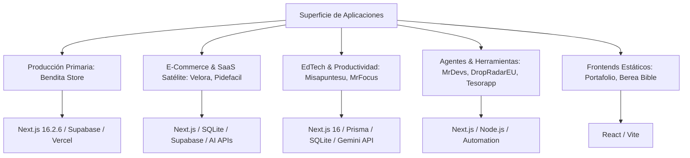

# 01 — Inventario Centralizado de Activos y Superficies de Ataque

**Equipo Auditor:** CISO, Application Security Architect, DevSecOps, Cloud Security Engineer  
**Fecha:** 2026-11-23  
**Alcance:** Aplicaciones web en el entorno autorizado `c:\Users\USER\Desktop\workspace`  
**Clasificación de Seguridad:** Confidencial / Uso Interno  

---

## 1. Resumen Ejecutivo de Descubrimiento

Se ejecutó un escaneo exhaustivo sobre los 21 directorios identificados en el entorno de desarrollo local. De ellos, se identificaron y categorizaron **10 aplicaciones web activas o en desarrollo**, estableciendo el estado del ciclo de vida, stack tecnológico, dependencias perimetrales y superficies de exposición hacia internet.

---

## 2. Inventario Detallado de Aplicaciones

### 2.1. Aplicación Primaria en Producción: Bendita Store (`benditastore`)
- **Directorio Raíz:** `c:\Users\USER\Desktop\workspace\benditastore`
- **Rol de Negocio:** Plataforma e-commerce B2C/B2B de perfumería, sistema POS (Punto de Venta) en mostrador, módulo contable/financiero, inventario de materias primas y gestión de lotes de producción.
- **Entorno:** Producción activa en Vercel (`benditastore.vercel.app` / dominio personalizado).
- **Stack Tecnológico:**
  - **Framework:** Next.js 16.2.6 (Turbopack, App Router, React Server Components).
  - **Lenguaje:** TypeScript 5.8 / Node.js v24.21.0 runtime.
  - **Backend / Persistencia:** Supabase PostgreSQL (Managed Cloud DB `vtnmuphfaxjiziknchnk`).
  - **Autenticación:** Supabase Auth (JWT HttpOnly cookies vía `@supabase/ssr` 0.5.2).
  - **Gestión de Estado:** Zustand 5.0.3 con persist middleware.
  - **Validación de Datos:** Zod 4.6.7 (actualizado por parche de seguridad contra DoS).
  - **Comunicaciones:** Resend API (transaccional), WhatsApp API direct link.
  - **Estilos:** Tailwind CSS 3.4.17, Lucide React 1.16.0.
  - **Testing:** Vitest 4.1.11, Testing Library React.
- **Superficie de Exposición:**
  - 35 rutas compiladas (RSC dinámicos, SSG prerenderizados y Middleware perimetral).
  - Rutas públicas: Catálogo (`/`, `/products`, `/product/[slug]`), Checkout (`/checkout`), Login/Registro (`/login`, `/register`).
  - Rutas protegidas: Portal cliente (`/account/*`), Backoffice ERP/POS (`/admin/*`).
  - Endpoints API públicos/restringidos: `/api/notify-order` (notificaciones transaccionales vía Resend), `/api/version`.

---

### 2.2. E-Commerce & Catálogos Satélites

#### Velora Store (`velora`)
- **Directorio:** `c:\Users\USER\Desktop\workspace\velora`
- **Estado:** En desarrollo / Clon especializado.
- **Stack:** Next.js 16.2.6, TypeScript, Supabase, Tailwind CSS.
- **Superficie de Ataque:** Catálogo dinámico, checkout con WhatsApp, llamadas API a Supabase.

#### Pidefácil (`Pidefacil`)
- **Directorio:** `c:\Users\USER\Desktop\workspace\Pidefacil`
- **Estado:** En desarrollo avanzado / Preproducción.
- **Stack:** Next.js 16.4.2, TypeScript, Supabase, SQLite local, Google Gemini API, Tesseract OCR, PM2 process manager.
- **Superficie de Ataque:** Carga y procesamiento OCR de recibos/imágenes, invocaciones a modelos LLM, bases de datos locales y sincronizadas.

---

### 2.3. EdTech y Aplicaciones de Productividad

#### Mis Apuntes U (`misapuntesu`)
- **Directorio:** `c:\Users\USER\Desktop\workspace\misapuntesu`
- **Estado:** En desarrollo activo.
- **Stack:** Next.js 16.4.6, Prisma ORM, SQLite (`dev.db`), Google Gemini API (`@google/genai`).
- **Superficie de Ataque:** Procesamiento de documentos de estudio, resúmenes con IA.
- **Hallazgo Crítico:** Exposición de clave de API en variable `NEXT_PUBLIC_GEMINI_API_KEY` dentro del frontend.

#### MrFocus (`mrfocus`)
- **Directorio:** `c:\Users\USER\Desktop\workspace\mrfocus`
- **Estado:** En desarrollo / Prototipo.
- **Stack:** Next.js 14.2.24, TypeScript, Supabase, SQLite, Lucide React.
- **Superficie de Ataque:** Métricas de productividad, timers, almacenamiento local y en la nube.

---

### 2.4. Plataformas Agentic & Automatización

#### MrDevs Agentic OS (`mrdevs`)
- **Directorio:** `c:\Users\USER\Desktop\workspace\mrdevs`
- **Estado:** En desarrollo experimental.
- **Stack:** Next.js 14.2.15, Supabase, `@xyflow/react` (flujos visuales de agentes).
- **Superficie de Ataque:** Orquestación de flujos de trabajo, ejecución de tareas automáticas.

#### DropRadar EU (`DropRadarEU`)
- **Directorio:** `c:\Users\USER\Desktop\workspace\DropRadarEU`
- **Estado:** Módulo de scraping/radar automatizado.
- **Stack:** Node.js, Express/Scraper dependencies.
- **Superficie de Ataque:** Ingesta de feeds externos, peticiones salientes continuas.

#### Tesorapp (`tesorapp`)
- **Directorio:** `c:\Users\USER\Desktop\workspace\tesorapp`
- **Estado:** En desarrollo.
- **Stack:** Node.js, SQLite/Backend utilities.
- **Superficie de Ataque:** Gestión financiera / conciliaciones.

---

### 2.5. Sitios Web Estáticos y Frontends React

#### Portafolio Web (`portafolio`)
- **Directorio:** `c:\Users\USER\Desktop\workspace\portafolio`
- **Estado:** En producción (GitHub Pages / Vercel).
- **Stack:** React 18, Vite, Lucide React, Tailwind CSS.
- **Superficie de Ataque:** Formularios de contacto estáticos, enlaces salientes.

#### Berea Bible Study (`bible`)
- **Directorio:** `c:\Users\USER\Desktop\workspace\bible`
- **Estado:** Publicado / Aplicación web interactiva.
- **Stack:** React 18, Vite, IndexedDB / JSON offline data.
- **Superficie de Ataque:** Almacenamiento local, búsqueda textual en el cliente.

---

## 3. Matriz Centralizada de Superficies y Componentes Críticos

| Aplicación | Framework | Base de Datos | Autenticación | APIs Externas | Nivel de Exposición |
| :--- | :--- | :--- | :--- | :--- | :--- |
| **Bendita Store** | Next.js 16.2.6 | Supabase PG | Supabase SSR JWT | Resend, WhatsApp | **Alto (Producción activa B2C/POS)** |
| **Velora** | Next.js 16.2.6 | Supabase PG | Supabase SSR | WhatsApp | Medio (Preproducción) |
| **Pidefácil** | Next.js 16.4.2 | Supabase / SQLite | Supabase Auth | Gemini LLM, Tesseract | Medio (OCR + AI Processing) |
| **Mis Apuntes U** | Next.js 16.4.6 | Prisma (SQLite) | Custom / NextAuth | Gemini LLM | Medio (Clave API en frontend) |
| **MrFocus** | Next.js 14.2.24 | Supabase / SQLite | Supabase Auth | N/A | Bajo (Desarrollo) |
| **MrDevs** | Next.js 14.2.15 | Supabase | Supabase Auth | LLM Orchestrators | Bajo (Experimental) |
| **DropRadar EU** | Node.js | Local JSON/DB | N/A | Scraping targets | Bajo (Worker interno) |
| **Tesorapp** | Node.js | SQLite | Local Auth | Bancarias / N/A | Bajo (Desarrollo) |
| **Portafolio** | React / Vite | N/A | N/A | Contact forms | Mínimo (Estático) |
| **Berea Bible** | React / Vite | IndexedDB | N/A | N/A | Mínimo (Offline first) |

---

## 4. Clasificación de Datos Manejados (Data Classification)

- **PII (Personally Identifiable Information):** Nombres de clientes, números de teléfono celular (WhatsApp), direcciones de despacho residenciales (Bendita Store, Pidefácil).
- **Datos Financieros:** Historial de transacciones de caja POS, montos pagados, costos de insumos, fletes de lotes, márgenes de ganancia (Bendita Store, Tesorapp).
- **Secretos y Credenciales de Plataforma:**
  - Claves Anon de Supabase (Públicas por diseño con RLS).
  - Claves Service Role de Supabase (Privadas, restringidas a Serverless backend).
  - API Keys de Resend (Privadas, envío de correo transaccional).
  - API Keys de Google Gemini (Privadas, backend IA).
