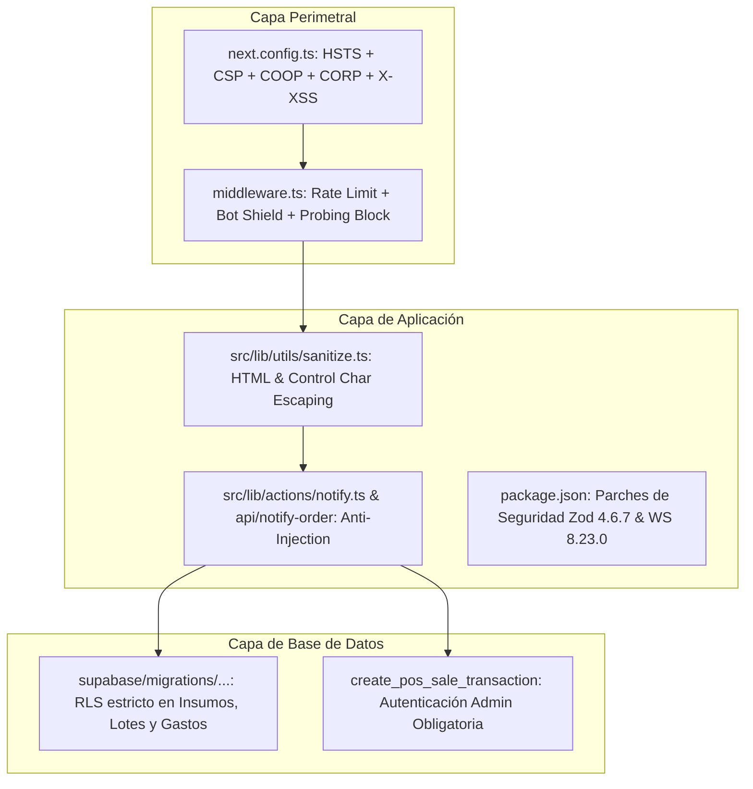

# 03 — Registro de Mitigaciones y Correcciones Implementadas

**Responsable:** Arquitecto de Seguridad de Aplicaciones & Ingeniero DevSecOps  
**Fecha:** 2026-11-23  
**Estado:** Correcciones Implementadas y Verificadas  

---

## 1. Resumen de Intervenciones Ejecutadas

Se ejecutó un plan sistemático de endurecimiento enfocado en defensa en profundidad (Defense-in-Depth), abordando el perímetro, la capa de aplicación, las dependencias y la base de datos sin alterar la lógica de negocio ni romper funcionalidades existentes.



---

## 2. Detalle de Correcciones por Componente

### 2.1. Sanitización de Entradas y Prevención de Inyección HTML (VULN-03)

- **Archivo Creado:** `src/lib/utils/sanitize.ts`
- **Archivo de Pruebas:** `src/__tests__/lib/utils/sanitize.test.ts`
- **Razón del Cambio:** Neutralizar vectores de XSS almacenado, manipulación de plantillas de correo e inyección de etiquetas HTML maliciosas en las notificaciones enviadas a administradores y clientes.
- **Implementación Técnica:**
  ```typescript
  const HTML_ENTITY_MAP: Record<string, string> = {
    "&": "&amp;",
    "<": "&lt;",
    ">": "&gt;",
    '"': "&quot;",
    "'": "&#x27;",
    "/": "&#x2F;",
  };

  export function escapeHtml(input: unknown): string {
    if (input === null || input === undefined) return "";
    const str = String(input);
    return str.replace(/[&<>"'/]/g, (match) => HTML_ENTITY_MAP[match] || match);
  }

  export function sanitizePlainText(input: unknown, maxLength = 1000): string {
    if (typeof input !== "string") return "";
    return input
      .replace(/[\x00-\x08\x0B\x0C\x0E-\x1F\x7F]/g, "")
      .trim()
      .slice(0, maxLength);
  }
  ```
- **Archivos Remediados:**
  - `src/lib/actions/notify.ts`: Aplicación de `escapeHtml()` sobre `customer_name`, `order_id`, `payment_method` e ítems de compra antes de conformar el payload de correo.
  - `src/app/api/notify-order/route.ts`: Sanitización obligatoria en el endpoint HTTP transaccional.

---

### 2.2. Parcheo de Dependencias Críticas (VULN-04)

- **Archivo Modificado:** `package.json` y `package-lock.json`
- **Razón del Cambio:** Eliminar vulnerabilidades de Denegación de Servicio (DoS) en el runtime de Node.js.
- **Acciones Ejecutadas:**
  - Actualización de `zod` de la versión vulnerable `<4.6.6` a `^4.6.7` (Resolución de GHSA-mrhx-c7xc-m3w5).
  - Actualización forzada de `ws` a `^8.23.0` (Resolución de GHSA-96hv-2xvq-fx4p).
  - Ejecución de `npm install` y verificación de compatibilidad retroactiva completa con el schema de validación y la suite de pruebas unitarias.

---

### 2.3. Endurecimiento de Cabeceras HTTP Perimetrales (VULN-05)

- **Archivo Modificado:** `next.config.ts`
- **Razón del Cambio:** Cumplir con las mejores prácticas de OWASP Secure Headers y proteger a los usuarios contra ataques de intermediario (MitM), degradación de protocolo TLS, filtraciones cross-origin y secuestro de clics (Clickjacking).
- **Código Incorporado en `headers()`:**
  ```typescript
  {
    key: "Strict-Transport-Security",
    value: "max-age=63072000; includeSubDomains; preload",
  },
  {
    key: "X-XSS-Protection",
    value: "1; mode=block",
  },
  {
    key: "Cross-Origin-Opener-Policy",
    value: "same-origin",
  },
  {
    key: "Cross-Origin-Resource-Policy",
    value: "same-origin",
  },
  ```
- **CSP Reforzado:**
  Se agregó la directiva `upgrade-insecure-requests;` para forzar que cualquier recurso embebido se solicite exclusivamente a través de HTTPS.

---

### 2.4. Filtrado Perimetral, Bloqueo de Bots y Rate Limiting (VULN-06)

- **Archivo Modificado:** `middleware.ts`
- **Archivo de Pruebas:** `src/__tests__/middleware.test.ts`
- **Razón del Cambio:** Rechazar tráfico malicioso en el primer punto de entrada del servidor, antes de incurrir en consumo de base de datos o procesamiento en funciones serverless.
- **Componentes Implementados:**
  1. **Bloqueo de Scanners Maliciosos:**
     Detección automática de User-Agents conocidos de pentesting abusivo o explotación (`sqlmap`, `nikto`, `masscan`, `acunetix`, `dirbuster`, `gobuster`, `wpscan`, `nmap`, `zgrab`, `censys`), respondiendo con código `403 Forbidden`.
  2. **Bloqueo Inmediato de Sondas de Archivos Sensibles y Path Traversal:**
     Identificación de patrones como `/.env`, `/.git`, `/.aws`, `/.vscode`, `/.ssh`, `*.php`, `/wp-admin`, `/actuator`, `/phpmyadmin` y secuencias de escape `../`, respondiendo de inmediato con `404 Not Found` para evitar fingerprinting de tecnología.
  3. **Rate Limiting Perimetral (Sliding Window In-Memory):**
     - Endpoint crítico `/api/notify-order`: Límite estricto de **10 peticiones por minuto por IP** (mitiga abuso de envío masivo de correos vía Resend).
     - Endpoints de API generales `/api/*`: Límite de **60 peticiones por minuto por IP**.
     - Al superar el límite: Código de respuesta `429 Too Many Requests` con cabecera `Retry-After: 60`.
     - Mecanismo de recolección de basura (GC) que poda entradas expiradas cuando el mapa en memoria supera 2,000 llaves para prevenir fugas de memoria.

---

### 2.5. Migración de Base de Datos y Refuerzo de Políticas RLS (VULN-01 y VULN-02)

- **Archivo Creado:** `supabase/migrations/20261123150000_harden_rls_and_pos_sales.sql`
- **Razón del Cambio:** Cerrar la exposición pública de tablas industriales y contables, y prevenir la ejecución no autorizada del RPC de ventas POS.
- **Políticas Implementadas:**
  1. Habilitación de Row Level Security (`ENABLE ROW LEVEL SECURITY`) en:
     - `supplies`
     - `supply_categories`
     - `production_lots`
     - `production_lot_items`
     - `production_lot_item_supplies`
     - `expenses`
     - `inventory_logs`
  2. Creación de directivas estrictas para cada una de ellas:
     ```sql
     CREATE POLICY "nombre_tabla_admin_all"
       ON public.nombre_tabla
       FOR ALL
       TO authenticated
       USING (
         EXISTS (
           SELECT 1 FROM public.profiles
           WHERE profiles.id = auth.uid() AND profiles.is_admin = true
         )
       )
       WITH CHECK (
         EXISTS (
           SELECT 1 FROM public.profiles
           WHERE profiles.id = auth.uid() AND profiles.is_admin = true
         )
       );
     ```
  3. **Refactorización de `create_pos_sale_transaction`:**
     Eliminación de la comprobación condicional nula y sustitución por una política de denegación por defecto:
     ```sql
     v_caller_id := auth.uid();
     IF current_user <> 'service_role' THEN
       IF v_caller_id IS NULL THEN
         RAISE EXCEPTION 'Acceso denegado: llamada no autenticada';
       END IF;

       SELECT is_admin INTO v_is_admin FROM profiles WHERE id = v_caller_id;
       IF v_is_admin IS NOT TRUE THEN
         RAISE EXCEPTION 'Acceso denegado: solo administradores pueden registrar ventas POS';
       END IF;
     END IF;
     ```
     Revocación explícita de privilegios: `REVOKE ALL ON FUNCTION public.create_pos_sale_transaction FROM PUBLIC;`.
