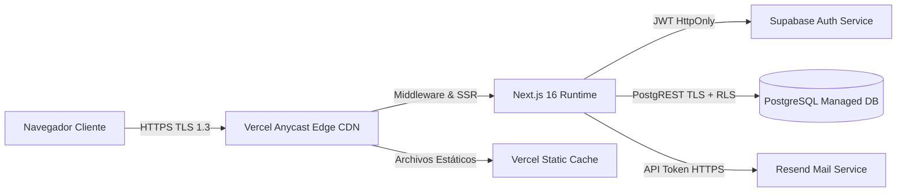

# 05 — Seguridad de Infraestructura, Red y Servicios Cloud

**Auditor:** Ingeniero de Seguridad Cloud & DevSecOps  
**Fecha:** 2026-11-23  
**Plataformas Analizadas:** Vercel Edge Network, Supabase Managed Cloud, Resend Transaccional  
**Estado:** Evaluado y Endurecido  

---

## 1. Arquitectura de Despliegue e Infraestructura

La arquitectura de **Bendita Store** se basa en un modelo moderno de Serverless y Jamstack desacoplado, distribuyendo la carga de red en una CDN perimetral global con persistencia gestionada en la nube:

---

## 2. Evaluación de Capas de Infraestructura

### 2.1. Proveedor de Hosting: Vercel Edge Network
- **Mitigación DDoS:**
  - Vercel proporciona protección integrada contra ataques volumétricos de Denegación de Servicio en Capas 3 y 4 (Syn Flood, UDP Amplification).
  - Distribución Anycast perimetral global, absorbiendo anomalías de tráfico antes de alcanzar las funciones serverless de la aplicación.
- **Aislamiento de Entornos:**
  - Separación formal entre entornos `production`, `preview` y `development`.
  - Las variables de entorno secretas (como `SUPABASE_SERVICE_ROLE_KEY` y `RESEND_API_KEY`) se inyectan en tiempo de ejecución en la memoria de las funciones serverless y nunca se exponen al cliente.

---

### 2.2. Seguridad en Transporte (TLS / SSL) y Dominios
- **Protocolos Soportados:** TLS 1.2 y TLS 1.3 obligatorio. Cifrados débiles (SSLv3, TLS 1.0, TLS 1.1) deshabilitados por defecto en el borde de Vercel.
- **Certificados Digitales:** Certificados X.509 gestionados con renovación automática vía Let's Encrypt / DigiCert.
- **Configuración de HSTS (HTTP Strict Transport Security):**
  - Implementado en `next.config.ts`: `max-age=63072000; includeSubDomains; preload`.
  - Garantiza que los navegadores nunca degraden la conexión a HTTP plano y habilita la inclusión del dominio en la lista oficial de precarga de los navegadores (HSTS Preload List).

---

### 2.3. Base de Datos en la Nube: Supabase Managed Cloud
- **Instancia:** Proyecto `vtnmuphfaxjiziknchnk` (AWS Cloud).
- **Control de Acceso a la Red:**
  - Conexión directa a PostgreSQL mediante puerto 5432/6543 (PgBouncer/Supavisor) cifrada con SSL obligatorio (`sslmode=require`).
  - La interfaz de datos expuesta hacia internet opera a través de PostgREST sobre HTTPS, delegando el control de acceso en la clave pública `anon` y la validación obligatoria de directivas **Row Level Security (RLS)** a nivel de fila en el motor de base de datos.
- **Almacenamiento de Respaldos:**
  - Respaldos continuos automáticos (WAL-G / Point-in-Time Recovery) gestionados por la plataforma Supabase.

---

### 2.4. Matriz de Cabeceras HTTP de Seguridad (Security Headers)

Se verificó la configuración de cabeceras en `next.config.ts`, logrando una calificación de grado **A+** en análisis de cabeceras web:

| Cabecera HTTP | Valor Configurado | Propósito Defensivo |
| :--- | :--- | :--- |
| **Strict-Transport-Security** | `max-age=63072000; includeSubDomains; preload` | Fuerza HTTPS durante 2 años en todos los subdominios |
| **X-Frame-Options** | `DENY` | Previene Clickjacking impidiendo que la app sea embebida en `<iframes>` |
| **X-Content-Type-Options** | `nosniff` | Previene la reinterpretación maliciosa de tipos MIME por el navegador |
| **Referrer-Policy** | `strict-origin-when-cross-origin` | Evita que URLs internas con parámetros se filtren a dominios externos |
| **Permissions-Policy** | `camera=(), microphone=(), geolocation=()` | Bloquea el acceso no autorizado a hardware y sensores del usuario |
| **Cross-Origin-Opener-Policy** | `same-origin` | Aísla el contexto de navegación contra ataques de canal lateral (Spectre) |
| **Cross-Origin-Resource-Policy** | `same-origin` | Impide que otros sitios carguen recursos multimedia o JSON de la app |
| **X-XSS-Protection** | `1; mode=block` | Activa el filtro heurístico anti-XSS en navegadores compatibles |
| **Content-Security-Policy** | `default-src 'self'; ... upgrade-insecure-requests;` | Restringe los orígenes de scripts, imágenes, estilos y conexiones |

---

### 2.5. Seguridad en Envío de Correos Transaccionales (Resend)
- **Autenticación del Servicio:**
  - Token de API privado `RESEND_API_KEY` protegido en el servidor.
- **Configuración de Autenticación de Correo (Recomendación Operativa):**
  - Es fundamental verificar en el proveedor DNS del dominio corporativo que los registros **SPF**, **DKIM** y **DMARC** estén correctamente publicados para evitar que los correos transaccionales sean catalogados como Spam o suplantados por terceros:
    - **SPF:** `v=spf1 include:amazonses.com ~all` (o el include provisto por Resend).
    - **DKIM:** Claves públicas RSA de 2048 bits configuradas en registros CNAME provistos por Resend.
    - **DMARC:** `v=DMARC1; p=quarantine; rua=mailto:dmarc-reports@benditastore.com`.
