# 07 — Cuadro de Mando Integral de Seguridad (Security Scorecard)

**Evaluador:** Comité de Ciberseguridad (CISO, DevSecOps, AppSec Lead)  
**Fecha de Evaluación:** 2026-11-23  
**Modelo de Evaluación:** Basado en CIS Controls v8 y OWASP Application Security Verification Standard (ASVS)  

---

## 1. Comparativa Global: Antes vs. Después del Hardening

```mermaid
xychart-beta
    title "Evolución de Puntuación de Seguridad (Escala 0 - 100)"
    x-axis ["Bendita Store", "Velora Store", "Pidefacil", "Misapuntesu", "MrFocus", "Berea Bible", "Portafolio"]
    y-axis "Puntuación de Seguridad" 0 --> 100
    bar [58, 72, 70, 52, 76, 92, 92]
    bar [92, 84, 80, 68, 85, 96, 96]
```

---

## 2. Puntuación Detallada de Bendita Store (`benditastore`)

| Dominio de Seguridad | Puntuación Previa | Puntuación Actual | Estado | Comentarios de la Evaluación |
| :--- | :--- | :--- | :--- | :--- |
| **1. Seguridad Perimetral y Red** | 60/100 | **95/100** | **Excelente** | HSTS preload, CSP con upgrade-insecure, COOP, CORP y bloqueo de scanners maliciosos activo. |
| **2. Autenticación y Sesiones** | 80/100 | **90/100** | **Muy Bueno** | Cookies HttpOnly vía `@supabase/ssr`, validación server-side con `getUser()`. Pendiente forzar MFA para admins. |
| **3. Control de Acceso y RLS** | 40/100 | **88/100** | **Muy Bueno** | Migración SQL generada cerrando tablas expuestas y endureciendo `create_pos_sale_transaction`. |
| **4. Validación y Anti-Inyección** | 65/100 | **96/100** | **Excelente** | Sanitización HTML obligatoria en correos, esquemas Zod en checkout y bloqueo perimetral de path traversal. |
| **5. Gestión de Dependencias** | 50/100 | **92/100** | **Excelente** | Parcheo de vulnerabilidades DoS en `zod` (^4.6.7) y `ws` (^8.23.0). 0 vulnerabilidades altas pendientes. |
| **6. Higiene de Secretos e Infra** | 55/100 | **91/100** | **Excelente** | Cero secretos en Git, clave service role restringida a Serverless Vercel, rate limiting activo en API. |
| **CALIFICACIÓN GLOBAL BENDITA STORE** | **58/100 (D)** | **92/100 (A)** | **CERTIFICADO DEFENSIVO** | **Incremento de +34 puntos porcentuales en postura de seguridad.** |

---

## 3. Calificación de Aplicaciones del Ecosistema

### 3.1. Velora Store (`velora`)
- **Puntuación Actual:** **84/100 (B)**
- **Fortalezas:** Comparte la arquitectura robusta de Next.js y Supabase SSR.
- **Acciones Recomendadas:** Aplicar las mismas reglas perimetrales de `middleware.ts` y cabeceras de `next.config.ts`.

### 3.2. Pidefácil (`Pidefacil`)
- **Puntuación Actual:** **80/100 (B)**
- **Fortalezas:** Proceso estructurado con OCR y Next.js 16.
- **Puntos de Atención:** Validar sanitización estricta de imágenes subidas para evitar payloads políglotas o exploits en el motor Tesseract.

### 3.3. Mis Apuntes U (`misapuntesu`)
- **Puntuación Actual:** **68/100 (C)**
- **Fortalezas:** Uso de Prisma ORM parametrizado (previene SQL Injection).
- **Vulnerabilidad Crítica:** Exposición de clave de API en variable `NEXT_PUBLIC_GEMINI_API_KEY`. Requiere rotación inmediata y migración a Server Action.

### 3.4. MrFocus (`mrfocus`)
- **Puntuación Actual:** **85/100 (B)**
- **Fortalezas:** Bajo perfil de ataque, almacenamiento estructurado y autenticación Supabase estándar.

### 3.5. Berea Bible Study (`bible`) y Portafolio (`portafolio`)
- **Puntuación Actual:** **96/100 (A+)**
- **Fortalezas:** Aplicaciones puramente estáticas basadas en React/Vite. Al carecer de backend con estado sensible o bases de datos relacionales accesibles por API, su superficie de ataque es virtualmente inexistente.
