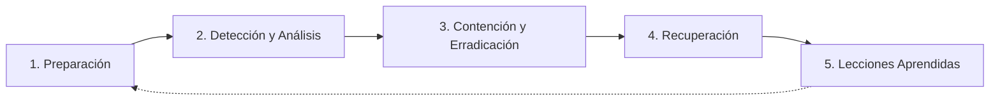

# 08 — Protocolo y Runbooks de Respuesta a Incidentes de Ciberseguridad

**Líder de Respuesta:** Especialista en Respuesta a Incidentes & CISO  
**Fecha:** 2026-11-23  
**Marco Metodológico:** NIST SP 800-61 Rev. 2 (Computer Security Incident Handling Guide)  

---

## 1. Fases del Ciclo de Vida de Respuesta a Incidentes



---

## 2. Runbook 1: Compromiso o Fuga de Credenciales / Claves de API

**Disparador:** Detección de una clave API privada (Resend, Supabase Service Role, Gemini) en repositorios públicos, registros de consola o transferencias no autorizadas.

### Fase 1: Contención Inmediata (< 15 minutos)
1. **Revocar la Clave Expuesta:**
   - Si es **Resend API Key:** Ingresar a `resend.com/api-keys`, eliminar la clave comprometida de inmediato. Cualquier llamada con la clave vieja fallará automáticamente con HTTP 401.
   - Si es **Google Gemini API Key:** Ingresar a Google AI Studio / Google Cloud Console > Credentials y deshabilitar/eliminar la clave.
   - Si es **Supabase Service Role Key:** Ingresar a `supabase.com/dashboard/project/vtnmuphfaxjiziknchnk/settings/api` y presionar **Generate New Secret** en la sección *JWT Secret*.
2. **Generar Nueva Credencial Segura:**
   - Crear una nueva clave con restricciones de IP o permisos mínimos requeridos.

### Fase 2: Despliegue y Erradicación (< 30 minutos)
1. Actualizar la variable correspondiente en el panel de **Vercel** (`Project Settings > Environment Variables`).
2. Disparar un nuevo despliegue en Vercel para propagar la nueva variable a todas las funciones activas:
   ```bash
   vercel --prod
   ```
3. Si el secreto se filtró en un commit de Git:
   - Reescribir el historial utilizando `git filter-repo` o `BFG Repo-Cleaner` para purgar el commit.
   - Forzar el push protegido al repositorio remoto.

### Fase 3: Análisis Post-Incidente
1. Revisar los registros de auditoría de Supabase (`Database > Audit Logs`) para identificar consultas ejecutadas por la clave comprometida durante el tiempo de exposición.
2. Comprobar si hubo exfiltración de pedidos, datos de clientes o modificaciones de inventario.

---

## 3. Runbook 2: Ataque de Denegación de Servicio (DoS / DDoS) o Abuso de API

**Disparador:** Picos anómalos de tráfico, saturación de funciones serverless, agotamiento de cuotas de correo en Resend o intentos masivos de scraping.

### Fase 1: Diagnóstico Rápido
1. Abrir **Vercel Analytics / Monitoring** para determinar:
   - IPs de origen principales.
   - User-Agents de las solicitudes.
   - Rutas más solicitadas (`/api/notify-order`, `/products`, etc.).

### Fase 2: Contención Perimetral
1. **Activar Protección Perimetral en Vercel:**
   - En el dashboard de Vercel, habilitar la regla de mitigación DDoS o Challenge Mode (si Vercel Firewall / Attack Mode está disponible).
2. **Bloqueo Inmediato en Middleware:**
   - Si el ataque proviene de un rango de IPs o User-Agent identificable, agregar el patrón a `BLOCKED_USER_AGENTS` o implementar un bloqueo por IP en `middleware.ts`:
     ```typescript
     const BANNED_IPS = ['x.x.x.x', 'y.y.y.y'];
     if (BANNED_IPS.includes(clientIp)) {
       return new NextResponse("Forbidden", { status: 403 });
     }
     ```
3. **Ajuste Temporal del Rate Limit:**
   - Reducir el umbral de `/api/notify-order` de 10 a 3 peticiones por minuto mientras dure el evento anómalo.

---

## 4. Runbook 3: Detección de Modificación No Autorizada en Base de Datos

**Disparador:** Discrepancias en saldos contables, órdenes creadas sin pago verificado, productos con precios alterados a cero o registros borrados.

### Fase 1: Aislamiento
1. Si se sospecha compromiso de cuentas administrativas:
   - Ir a **Supabase Dashboard > Authentication > Users**.
   - Restablecer contraseñas o deshabilitar temporalmente los usuarios sospechosos.
   - Invalidar todas las sesiones JWT activas desde la configuración de Auth.
2. Si se sospecha explotación de un endpoint público:
   - Activar temporalmente el modo de mantenimiento en Next.js devolviendo HTTP 503 en el middleware para rutas no esenciales.

### Fase 2: Recuperación de Datos (Point-in-Time Recovery)
1. Supabase realiza copias de seguridad automáticas de PostgreSQL.
2. Contactar a soporte de Supabase o utilizar la consola de **Database > Backups** para restaurar el estado de la base de datos al minuto previo a la inyección maliciosa.
3. Contrastar las tablas de ventas (`pos_sales`, `orders`) con los comprobantes físicos o comprobantes bancarios de WhatsApp para validar la integridad final.

---

## 5. Matriz de Escalamiento y Contactos de Emergencia

| Rol | Responsabilidad | Canal de Contacto Primario | Tiempo Máximo de Respuesta |
| :--- | :--- | :--- | :--- |
| **Lead Developer / DevSecOps** | Contención de código, despliegue y rotación de claves | Teléfono / Mensajería Directa | < 15 minutos |
| **Administrador de Infraestructura** | Soporte con Vercel, Supabase y DNS | Consola Cloud / Email | < 30 minutos |
| **CISO / Dueño del Negocio** | Declaración de incidente, notificación a clientes si aplica | Teléfono | Inmediato |
