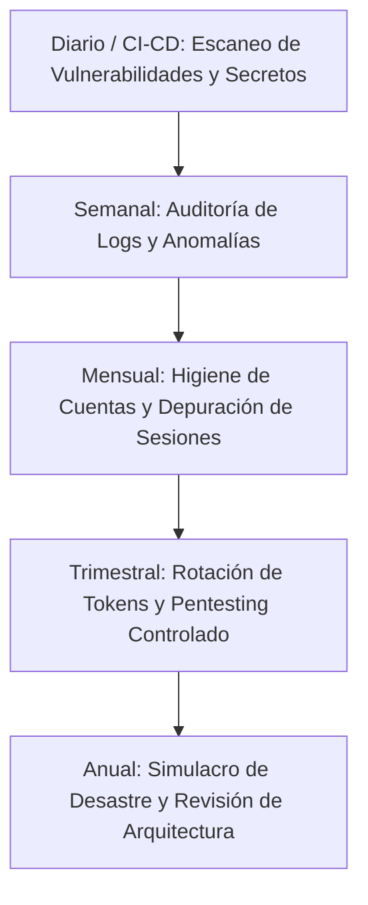

# 09 — Plan de Mantenimiento Continuo y Calendario de Auditorías

**Responsable:** Ingeniero DevSecOps & CISO  
**Fecha:** 2026-11-23  
**Vigencia:** Anual (Revisión periódica obligatoria)  

---

## 1. Filosofía de Mantenimiento Preventivo

La seguridad no es un estado estático, sino un proceso operacional continuo. A medida que surgen nuevos vectores de ataque, dependencias desactualizadas o modificaciones en el código de la tienda, este plan asegura que el estándar de seguridad alcanzado se preserve en el tiempo.



---

## 2. Calendario de Tareas de Seguridad Periódicas

| Frecuencia | Tarea de Seguridad | Herramienta / Método | Criterio de Éxito |
| :--- | :--- | :--- | :--- |
| **Continuo (CI/CD)** | Análisis de composición de software (SCA) | `npm audit` / Dependabot | 0 vulnerabilidades de severidad Alta o Crítica |
| **Continuo (CI/CD)** | Detección de secretos en commits | Git Pre-commit hook / Gitleaks | 0 claves de API o tokens rastreados en git |
| **Continuo (CI/CD)** | Suite de pruebas automatizadas | `npm run test` (Vitest) | 100% de pruebas de seguridad y lógica aprobadas |
| **Semanal** | Revisión de tasa de errores 4xx y 5xx | Vercel Observability | Sin picos de códigos 429 (abusos) o 500 (fallos) |
| **Semanal** | Monitoreo de consultas sospechosas | Supabase Logs | Sin intentos recurrentes de violaciones de RLS |
| **Mensual** | Auditoría de usuarios administradores | Supabase Auth > Users | Solo personal autorizado activo con rol `is_admin = true` |
| **Mensual** | Verificación de integridad de respaldos | Supabase Backup Console | Puntos de restauración automáticos activos y consistentes |
| **Trimestral** | Rotación planificada de claves de servicio | Resend, Supabase API Keys | Tokens antiguos revocados sin disrupción operativa |
| **Trimestral** | Simulación de pentesting perimetral | Escaneo defensivo autorizado | Sin puertos abiertos, cabeceras web vigentes |
| **Semestral** | Simulacro de recuperación ante desastres (DRP) | Restauración de base de datos | Tiempo de recuperación (RTO) < 1 hora, pérdida de datos (RPO) < 15 min |
| **Anual** | Revisión completa de políticas y arquitectura | CISO / Comité Técnico | Actualización de runbooks y matriz de riesgos |

---

## 3. Automatización de Seguridad Recomendada en GitHub Actions

Para asegurar que ningún commit futuro introduzca regresiones de seguridad o dependencias vulnerables, se recomienda incluir en el repositorio el siguiente flujo de trabajo de integración continua (`.github/workflows/security.yml`):

```yaml
name: Security Audit & Verification

on:
  push:
    branches: [main]
  pull_request:
    branches: [main]

jobs:
  security-check:
    name: DevSecOps Pipeline
    runs-on: ubuntu-latest

    steps:
      - name: Checkout Code
        uses: actions/checkout@v4

      - name: Setup Node.js
        uses: actions/setup-node@v4
        with:
          node-version: 20
          cache: 'npm'

      - name: Install Dependencies
        run: npm ci

      - name: Audit Dependencies (SCA)
        run: npm audit --audit-level=high

      - name: Execute Security & Unit Tests
        run: npm run test

      - name: Verify TypeScript & Production Build
        run: npm run build
        env:
          NEXT_PUBLIC_SUPABASE_URL: ${{ secrets.NEXT_PUBLIC_SUPABASE_URL }}
          NEXT_PUBLIC_SUPABASE_ANON_KEY: ${{ secrets.NEXT_PUBLIC_SUPABASE_ANON_KEY }}
```

---

## 4. Lista de Chequeo para Nuevos Despliegues (Pre-Deployment Checklist)

Antes de promover cambios relevantes a producción en `benditastore` o aplicaciones satélites:

- [ ] ¿Se ejecutó `npm audit` y se verificó que no existan vulnerabilidades altas o críticas?
- [ ] ¿Todas las entradas de usuario en nuevas vistas se validan con esquemas de Zod?
- [ ] ¿Cualquier dato dinámico incorporado en correos o HTML pasa por `escapeHtml()`?
- [ ] ¿Toda nueva tabla creada en Supabase tiene ejecutado `ENABLE ROW LEVEL SECURITY`?
- [ ] ¿Se probaron consultas con la clave pública `anon` para garantizar que no haya exposición no deseada?
- [ ] ¿Se ejecutaron las 79 pruebas unitarias (`npm run test`) exitosamente?
- [ ] ¿El build de Next.js (`npm run build`) finalizó con código 0?
